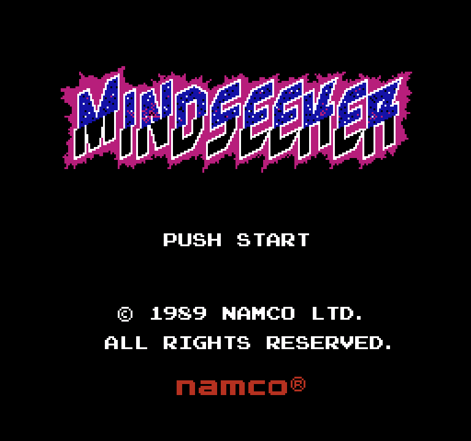
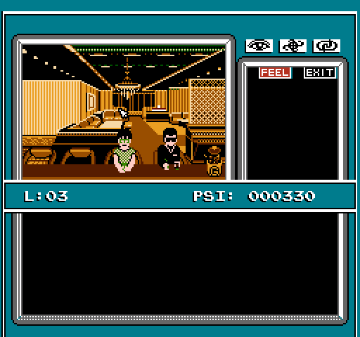

# Mindseeker - English Translation

An English translation of *Mindseeker* (マインドシーカー), Namco's 1989 Famicom adventure game, in which you train your psychic powers through feats of RNG, while supervised by Esper Kiyota (Masuaki Kiyota). This is an IPS patch for the original Japanese ROM.

<p align="center"></p>

## What's translated

- All 322 lines of dialogue, printed by a new text engine in boxes of 24 columns by 3 lines.
- The menus and command panels, the name entry grid (capitals, lowercase and `. ' " - ! ?`), the message speed box and the new game prompt.
- The title screen: TEXT SPEED in the menu, and the namco® mark from Namco's US releases in place of "namcot".
- The opening crawl that plays when the title screen is left alone, and the six sayings at the end of the game.
- The Esper Rating screen (TOTAL, CLAIR, PK, PRECG) and the card test's menu row.

<p align="center">
  <br>
  <em>The opening crawl, shown at 1.5 times speed.</em>
</p>

<p align="center">
  <br>
  <em>Esper Arima in the Psi Salon. In Japanese the joke is about Famista, Namco's Family Stadium, which came out in North America as R.B.I. Baseball.</em>
</p>

## Patching

1. Find your own copy of the Japanese ROM.
   - File: `Mindseeker (Japan).nes`
   - CRC32: `A4A96B38`
   - SHA-1: `9701830b9827b7fccaa7888452c27fdea43b38ed`

   The patch expects the file with its 16-byte iNES header. A headerless dump (CRC32 `ACE56F39`) won't patch correctly.

2. Download `mindseeker_en.ips` from the [releases page](../../releases).
3. Apply it with an IPS patcher, such as [Rom Patcher JS](https://www.marcrobledo.com/RomPatcher.js/) in a browser or [Floating IPS](https://github.com/Alcaro/Flips).
4. Check the result. The patched ROM from this release (build 9) has CRC32 `6FFE6DE1` and SHA-1 `b1f1a8ebeea6ce3c0680d44bdbd60c2cd0c4d059`.

## Playing

The game uses Namco's 163 mapper (iNES mapper 19) with battery-backed saves, so it needs an emulator or flash cart that supports it. The whole game was played through in Mesen. An automated test in MesenCE 2.2.1 also had the game print all 322 lines and checked every text box. The patch hasn't been tried on original hardware yet.

## Differences from the original

- English needs more room than kana, so some lines take one or two more boxes.
- TEXT SPEED on the title menu, instead of MESSAGE SP.
- In the card test, the original's first menu slot (＊＊) ignored the A button. It's hidden, and the cursor starts on 1P.

## Building

The build reads the Japanese ROM, rewrites its text and graphics, and writes the patched ROM and the patch to `dist/`.

1. Install Python 3 and [Pillow](https://python-pillow.org/).
2. Put `Mindseeker (Japan).nes` in the repository's root folder.
3. Put [Press Start 2P](https://fonts.google.com/specimen/Press+Start+2P) at `project-data/fonts/pressstart2p/PressStart2P-Regular.ttf`.
4. Run:

   ```sh
   python3 tools/dump_script.py
   python3 tools/build.py
   python3 tools/make_csv.py
   python3 tools/verify.py
   ```

`verify.py` runs 24 checks on the result, including that the patch rebuilds the ROM byte for byte and that nothing outside the translated areas changed. `dist/mindseeker_script.csv` lists every line in Japanese, a literal translation, and the final English.

## Credits

- **Mindseeker** by Namco, supervised by Masuaki Kiyota
- **Press Start 2P** by CodeMan38, the font for the English text
- **Mesen** by Sour, and its MesenCE fork, the emulators it was tested in
- **GForce645**, whose GameFAQs walkthrough mapped out the game for testing

## License

This translation is free software under the [GNU General Public License, version 3 or later](LICENSE). The Press Start 2P font is under the SIL Open Font License 1.1.

This translation isn't affiliated with Namco or Bandai Namco Entertainment.

---

*This project was made with AI assistance. The translation was made with the help of Claude Fable 5.2 and Gemini 4 Neon before being fully proofread and edited by myself. For more information on how I use AI, see [my AI usage statement](https://github.com/cmyksoda/cmyksoda/blob/main/AI_USAGE.md).*
